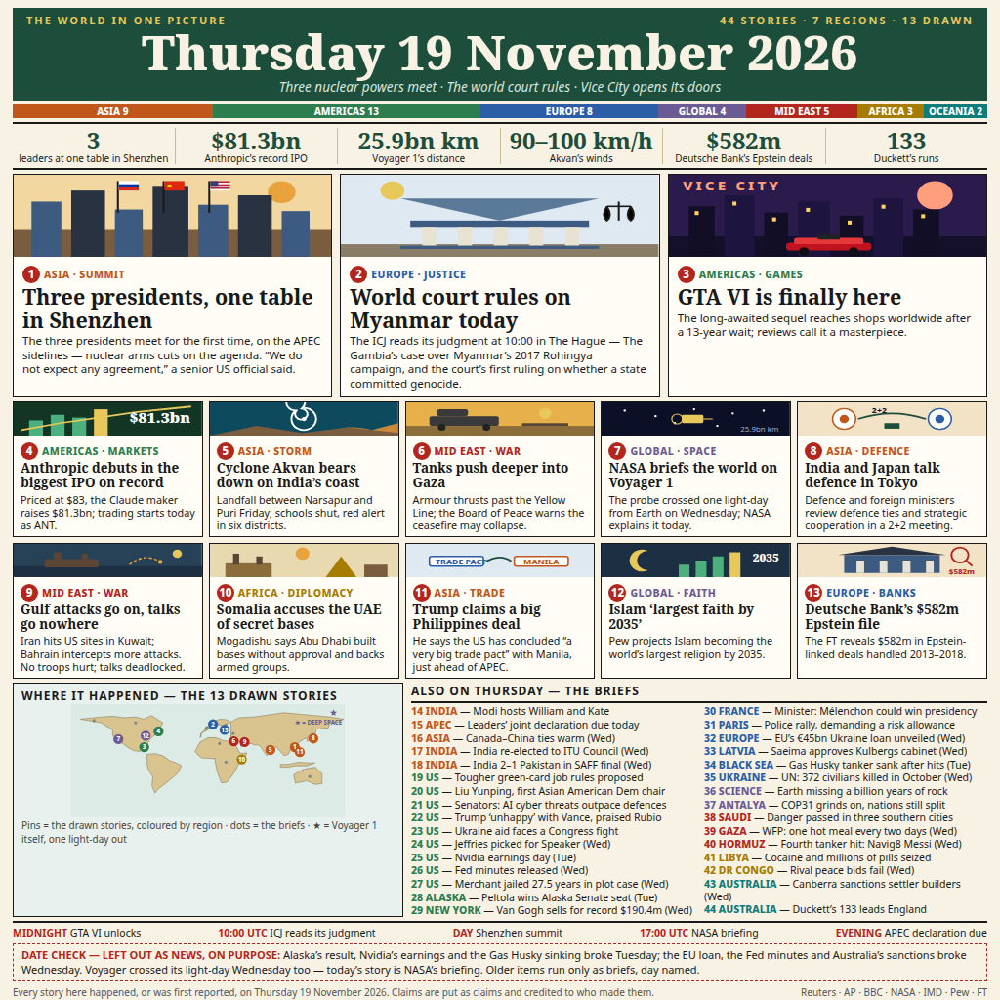

# Thursday 19 November 2026: 44 stories, every lead story drawn

A one-page broadsheet summing up Thursday 19 November 2026 — 13 drawn
stories (3 heroes + 10 mediums), 31 numbered briefs, a region bar, a
numbers strip, a by-the-clock timeline, a pin map and a date-check strip.

## The 13 drawn stories

1. Three presidents, one table in Shenzhen (Asia)
2. World court rules on Myanmar today (Europe)
3. GTA VI is finally here (Americas)
4. Anthropic debuts in the biggest IPO on record (Americas)
5. Cyclone Akvan bears down on India's coast (Asia)
6. Tanks push deeper into Gaza (Middle East)
7. NASA briefs the world on Voyager 1 (Global)
8. India and Japan talk defence in Tokyo (Asia)
9. Gulf attacks go on, talks go nowhere (Middle East)
10. Somalia accuses the UAE of secret bases (Africa)
11. Trump claims a big Philippines deal (Asia)
12. Islam 'largest faith by 2035' (Global)
13. Deutsche Bank's $582m Epstein file (Europe)

## The briefs (14–44)

Asia: Modi hosts William and Kate; APEC leaders' joint declaration
due today; Canada–China ties warm (Wed); India re-elected to the ITU
Council (Wed); India 2–1 Pakistan in the SAFF final (Wed). Americas:
tougher green-card job rules proposed; Liu Yunping, first Asian
American Dem chair; senators: AI cyber threats outpace defences;
Trump 'unhappy' with Vance, praised Rubio; Ukraine aid faces a
Congress fight; Jeffries picked for Speaker (Wed); Nvidia earnings
day (Tue); Fed minutes released (Wed); Merchant jailed 27.5 years in
plot case (Wed); Peltola wins Alaska Senate seat (Tue); Van Gogh
sells for record $190.4m (Wed). Europe: minister: Mélenchon could win
presidency; Paris police rally, demanding a risk allowance; EU's
€45bn Ukraine loan unveiled (Wed); Saeima approves Kulbergs cabinet
(Wed); Gas Husky tanker sank after hits (Tue); UN: 372 civilians
killed in October (Wed). Global: Earth missing a billion years of
rock; COP31 grinds on, nations still split. Middle East: danger
passed in three Saudi southern cities; WFP: one hot meal every two
days (Wed); fourth tanker hit: Navig8 Messi (Wed). Africa: cocaine
and millions of pills seized in Libya; rival peace bids fail in DR
Congo (Wed). Oceania: Canberra sanctions settler builders (Wed);
Duckett's 133 leads England.

## Region counts

Asia 9 · Americas 13 · Europe 8 · Global 4 · Middle East 5 · Africa 3 ·
Oceania 2 = 44 stories.

## How it was built

`poster.html` is a hand-drawn flat-illustration front page (inline SVG,
system fonts, no network). It was rendered to `entry.png` with headless
Chrome at 1024×1024. `main.py` copies `entry.png` to
`$MAKEFUN_OUTPUT_DIR/entry.png`, verifying the copy by sha256.

## Sources

Reuters · AP · BBC · NASA · IMD · Pew · FT. Every story happened, or
was first reported, on Thursday 19 November 2026; older items run only
as day-labelled briefs or in the date-check strip.
